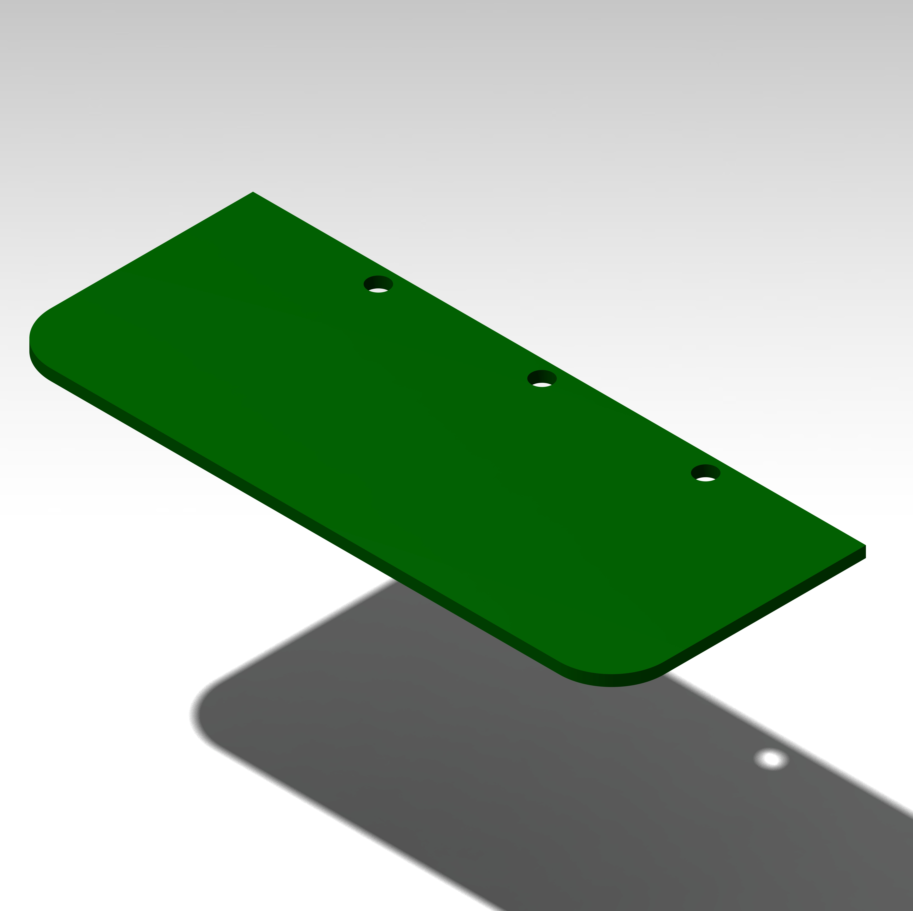

# gatchina-ctop

Classic rectangular worktop

## Features
- for comfort and safety, sharp corners are rounded
- there are three cutouts for cable routing to install "standard" cable channels
- the use of elbow supports is recommended

## Drawings

## Images

