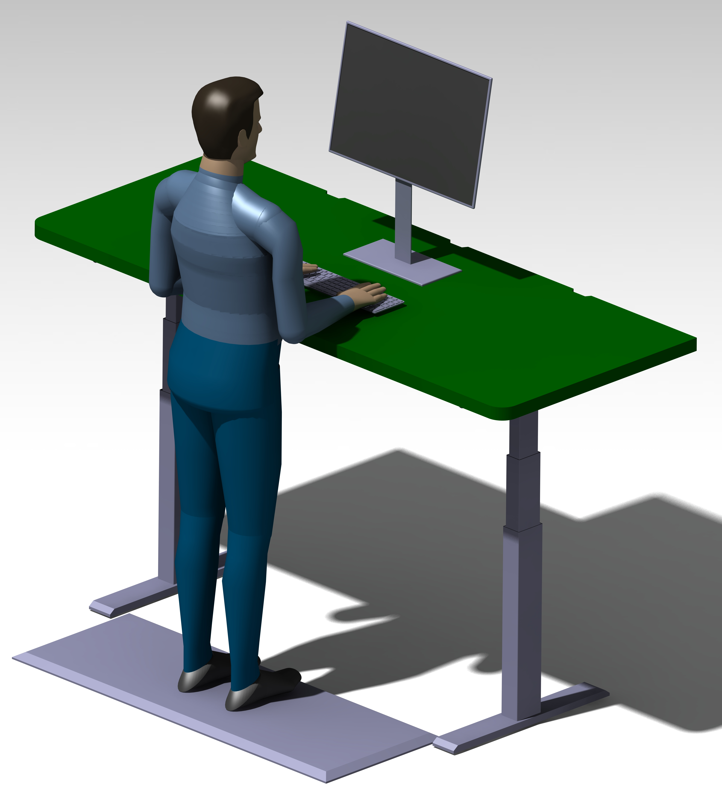

# TableTopGatchina

Стандартная прямоугольная столешница

## Детали
- ближние углы скруглены
- вырезы для прохода кабельных трас

Трёхмерные модели и чертежи находятся в папке проекта `Документы`.

## Документы

## Изображения

## Рекомендации
- использовать поддержки для локтей

---

Разработано специально для [StandCat](https://gitverse.ru/ekotov/StandCat)
