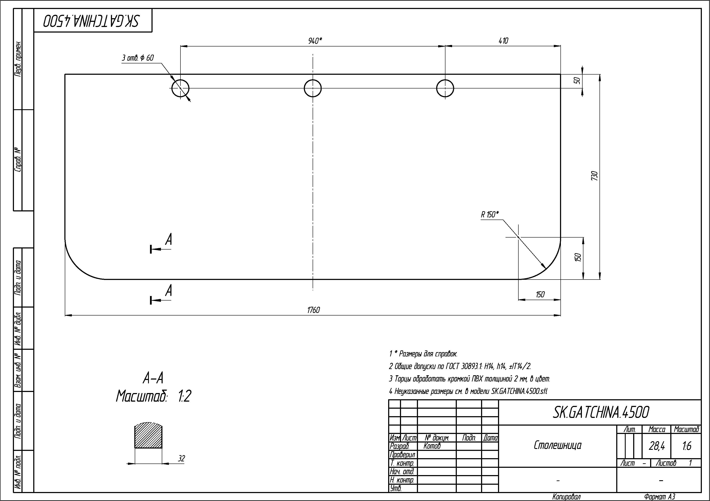
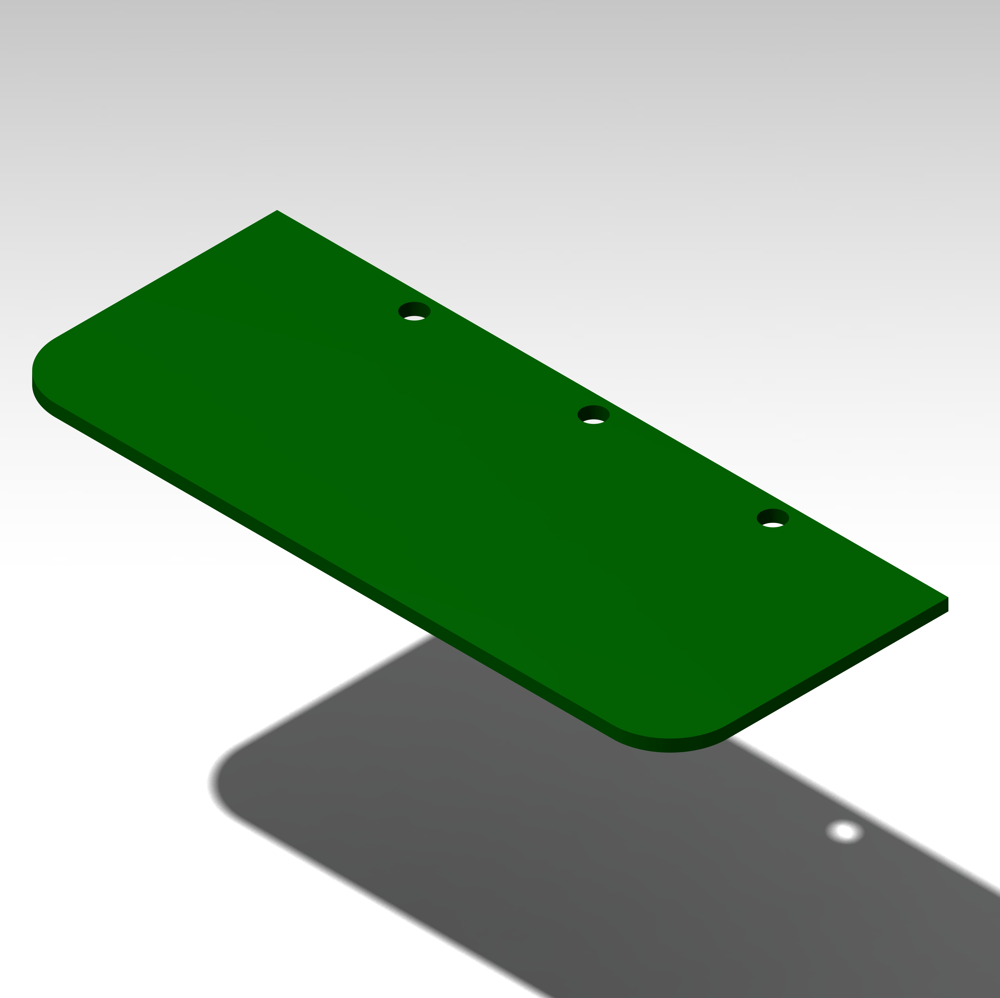
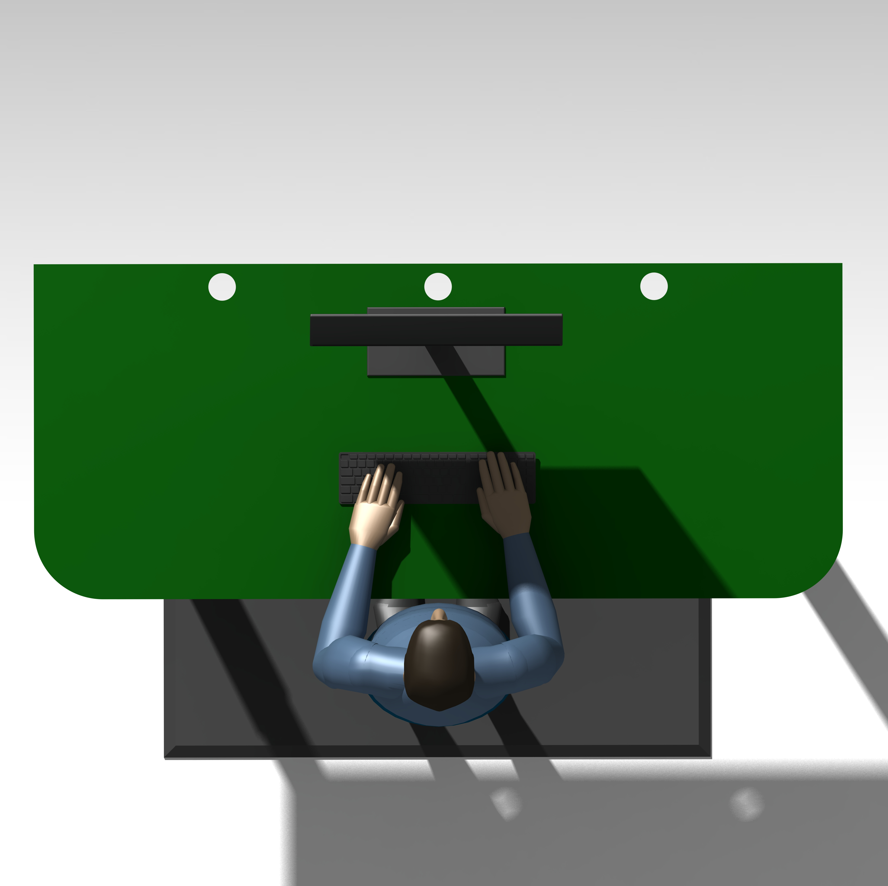
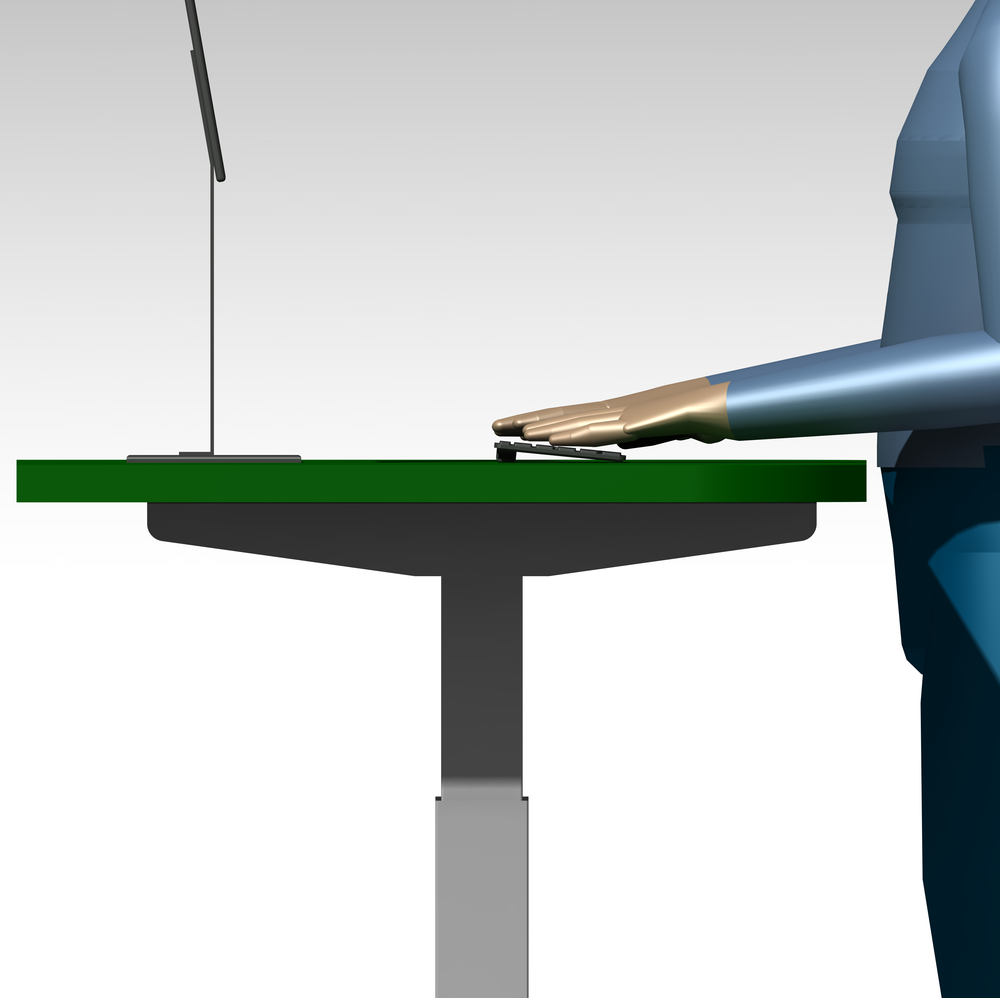
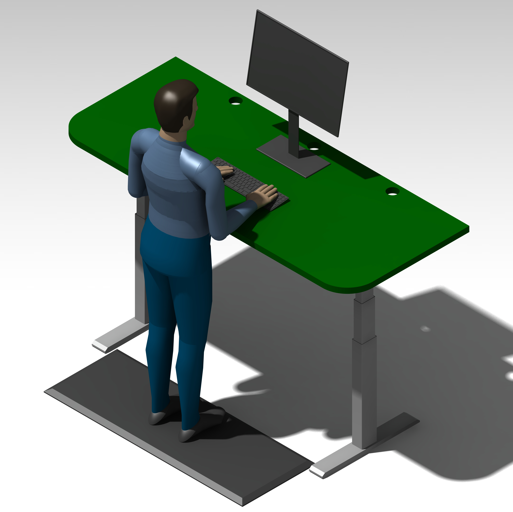

# TableTopGatchina

Классическая прямоугольная столешница

## Детали
- для комфорта и безопасности острые углы скруглены
- имеются три выреза для прохода кабельных трас под установку "стандартных" кабельных каналов

## Документы

## Изображения

## Особенности
- рекомендуется использовать поддержки для локтей

---

Трёхмерные модели и чертежи находятся в папке проекта `Документы`.
Разработано специально для [StandCat](https://gitverse.ru/ekotov/StandCat)
